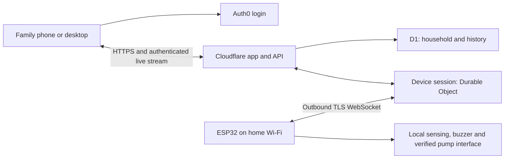

# Household water-level app plan

Prepared 10 October 2026, updated 11 October for Android-first delivery. App implementation is in `app/`; no firmware, cloud resources or motor wiring changed.

## Product and scope

Build an Android app first for one household, with individual Auth0 logins and shared access to one tank initially. Package the React interface with Capacitor, including Android back navigation, system-browser login via a Native Auth0 client, and outbound HTTPS requests to the cloud backend. A browser preview and optional web deployment share the interface. iOS is a later platform. Use a household/device data model so another tank can be added later.

Start with internet monitoring, alerts, diagnostics and buzzer controls. Add motor control after the starter interface, calibration and actual motor-state feedback are verified. Consumer button pushers remain a possible supervised prototype interface, not the sole unattended shutdown mechanism.

The existing firmware is water-level-v3. It samples three electrodes: 20% on GPIO36, 50% on GPIO34 and 100% on GPIO32, with common excitation on GPIO14 and an active buzzer on GPIO23. It has local Wi-Fi provisioning, calibration, fault handling, authenticated HTTP status and browser OTA. It has no cloud connection or pump control. Final installed-tank calibration and audible buzzer verification remain commissioning checks.

## User experience

### Home

- Tank name and an accessible tank illustration showing the measured band: below 20%, 20-50%, 50-100%, or full.
- Do not invent a continuous percentage, volume, consumption rate or time-to-empty from three binary level probes. Sensor placement at height is not necessarily equal to tank-volume percentage.
- Separate water condition from device connection: last good reading, last contact, offline, sensor fault and uncalibrated all have distinct labels.
- Show the reading age. Offline data is visibly historical, not a live measurement.
- Buzzer state and alarm preferences, with a bounded test button.
- Pump controls appear only for a commissioned device with the required capability. Show requested output separately from verified motor running state.

### History and alerts

- Stepped level timeline; gaps during offline periods instead of connecting them as measured values.
- Low-level episodes, full events, sensor faults, reconnects and command history.
- Alerts have timestamps, acknowledgement and resolution. Acknowledging a notification does not disable the local alarm or resolve the condition.
- Preserve the current local LOW buzzer policy: one minute of intermittent beeps every ten minutes, stopping when the 20% electrode is confirmed wet. FULL stays silent locally.
- Proposed app defaults: LOW, sensor fault and sustained offline alerts enabled; full notification optional. Deduplicate episodes and apply cooldowns.
- Start with in-app alerts. Add Android push via Firebase Cloud Messaging with notification permission and backend delivery, then web push if the browser version is deployed. Email is an optional fallback. SMS/WhatsApp needs a separate provider and cost decision.

### Household and settings

- Invite family members, change roles and revoke access.
- Owner-only device pairing, renaming, calibration, network guidance and automation configuration.
- Calibration wizard explains the physical dry/wet steps and reports quality before saving. Calibration locks out motor starts and exits safely after interruption.
- Diagnostics show electrode readings, firmware, Wi-Fi signal, uptime, calibration quality and connection history without exposing credentials.
- Show local recovery instructions when cloud access is unavailable.

## Recommended stack

| Layer | Proposed choice | Purpose |
| --- | --- | --- |
| App | React, TypeScript and Vite; PWA support | Phone and desktop UI |
| Hosting/API | Cloudflare Workers + Static Assets; TypeScript API | One HTTPS origin for app and API |
| Human login | Auth0 Universal Login and React SDK | Individual logins using Authorization Code + PKCE |
| Household records | Cloudflare D1 | Membership, devices, settings, history and audit records |
| Live device session | One SQLite-backed Durable Object per device | Coordinate live state, connection ownership and commands |
| Transport | Outbound TLS WebSocket from ESP32 | Telemetry and commands through normal home Wi-Fi/NAT |
| Firmware | Existing PlatformIO Arduino project | Local sensing, alarms, recovery and eventual motor rules |

Workers can serve the app and API together. Durable Objects offer a hibernation WebSocket API; use it rather than keeping an idle server task running. No router port forwarding or permanent home computer is required. MQTT is a valid future alternative but is not required for this household deployment.

Diagram:

## Authentication and authorization

### People

- Register an Auth0 Single Page Application and a separate API audience. Use the maintained Auth0 SDK; do not implement the OAuth protocol manually.
- Configure exact development and production callback, logout and allowed-origin URLs. Do not use broad wildcard production callbacks.
- The API verifies access-token signature using Auth0 JWKS, allowed algorithm, issuer, audience, expiry and appropriate scopes. ID tokens are not API bearer credentials.
- Browser tokens stay in memory by default. If persistent sessions are required, explicitly design SDK refresh-token rotation and expiry handling; do not casually store tokens in localStorage.
- Household membership is enforced by the API on every protected operation. Auth0 proves identity; an app database determines which tank and actions that identity can access.
- Bind users to Auth0 subject identifiers, not a submitted email address. Invitations are expiring and single-use, and acceptance requires the intended verified identity.
- Public sign-up never automatically grants household membership. First owner is explicitly provisioned; subsequent users join through invitations.

| Household role | Permissions |
| --- | --- |
| Viewer | View level, device health, history and alerts |
| Operator | Viewer access plus permitted buzzer and commissioned pump actions |
| Owner | Operator access plus members, device enrollment, calibration and policies |

- Do not put Auth0 Management API secrets in the app or ESP32. Keep any server-only credentials in cloud secrets.
- Browser WebSocket connections use short-lived, one-use session tickets obtained through an authenticated API request. Do not place reusable Auth0 tokens in URLs.
- Live subscriptions have a bounded lifetime and must reauthenticate. Membership changes revoke active subscriptions and command access, not just future page loads.

### ESP32

- Give each device a separate randomly generated credential scoped to its own device. Human Auth0 tokens and shared household passwords are not device credentials.
- Enrollment starts through a physically initiated local setup session. Use a high-entropy, short-lived, one-use pairing code visible only locally; the logged-in owner claims it through the app.
- The initial device credential is issued to the matching enrollment session over verified TLS, stored in ESP32 NVS, and hashed in the backend. Never expose it to the browser after enrollment or log it.
- Support revocation and deliberate credential rotation. Account unlinking also invalidates the active device connection.
- A device is allowed to report its own telemetry, receive its own permitted commands and acknowledge them. It cannot invite users or read other devices.
- Verify server certificates and establish valid time before connecting; never use an insecure TLS mode to bypass certificate errors. Credential extraction from an unprotected physical ESP32 remains a threat; encrypted storage and secure boot need a separate board/firmware assessment.

## Telemetry and command protocol

### Telemetry

- A versioned message includes device ID, boot ID, sequence number, firmware, capabilities, uptime, measurement age, band, per-probe state/median/calibration, fault, buzzer state and Wi-Fi signal.
- Use server receive time as authoritative arrival time. Device timestamps, when synchronized, describe measurement time but are not blindly trusted for command expiry.
- Publish confirmed changes promptly and a regular heartbeat. Initial target: latest state within roughly ten seconds; offline indication after thirty seconds without a valid heartbeat. These are cloud freshness targets, separate from existing ADC freshness rules.
- Track boot IDs and sequences to reject old/out-of-order samples and replace abandoned connections deliberately.
- Store immediate level/fault changes plus one-minute summaries. Keep summaries for 90 days initially and audit/events for one year, subject to measured storage cost.
- Keep only current state and command coordination in the device Durable Object; use D1 for household records and queryable history. Define the device session as the authority for command transitions and export audit events with deduplication/retry to D1.

### Commands

- Supported first commands: short buzzer test, bounded ten-second diagnostic test, alarm enable/disable and calibration operations with explicit preconditions.
- Future motor commands are separate, capability-gated operations rather than generic GPIO writes from the browser.
- Each command has a UUID, device ID, authenticated actor, action, creation time, short expiry, expected boot/session and relevant configuration revision.
- The device independently checks expiry, current session, capability, local mode, fresh calibration/state and interlocks before acting. A cloud permission check is necessary but cannot substitute for these local checks.
- Show accepted, delivered, completed, rejected, expired and outcome-unknown distinctly. An HTTP success or relay activation does not prove the motor started.
- Persist command state before delivery; bound retries and deduplicate repeated IDs on the ESP32. Never replay a START after reconnect or reboot. If execution may have occurred but acknowledgement was lost, mark it uncertain and reconcile actual feedback rather than promising exactly-once physical action.
- Give STOP priority, cancel conflicting pending starts, serialize commands per device and rate-limit tests/control operations. Offline START is rejected. Offline STOP is reported as undelivered; the UI cannot claim a stopped motor without feedback.
- State changes and rejected actions are audited with actor, device and result. Audit retries must not re-execute commands.

## Motor control release requirements

These are proposed requirements for the later control release, not an assertion that the current starter is ready.

- Complete starter terminal tracing, fitted coil identification, suitable interface selection and electrical commissioning independently of app work.
- Preserve manual STOP and existing protection. Provide an independent shutdown appropriate to unattended filling; the cloud and a battery button pusher are not that shutdown.
- Add isolated contactor auxiliary feedback or another suitable motor-state sensor. Relay state, contactor state and confirmed water flow are different measurements; the app names them accurately.
- Decide automatic fill thresholds explicitly. A candidate policy is start below 20% and stop at 100%, but this has not yet been requested/approved as the motor policy.
- Implement a local state machine with disabled, manual and automatic modes. Default to disabled after initial installation. Controller reboot does not restore a remembered remote START.
- Local limits include full-level stop, sensor fault/stale-reading stop, maximum runtime, anti-short-cycle delay and a hardware-limited starting-capacitor sequence where needed.
- Controller loss must remove permission to run through the chosen interface. Define and test the actual behavior, including relay failure and stuck actuator cases.
- On internet loss, approved local automatic operation may continue only under fresh valid sensors and local safeguards. A remote manual run uses a bounded local lease/runtime and stops when that expires. Cloud loss is visibly reported; it does not disable local safeguards.
- A physical service/disable mode prevents remote operation during maintenance. Starting while calibrating or updating is rejected.
- Automatic filling requires final tank calibration and commissioning. Calibration status is explicit in the app.

## Backend records and API outline

Records: users (Auth0 subject), households, memberships, invitations, tanks, devices, device credentials, enrollment sessions, calibration/configuration revisions, telemetry summaries, events, commands, alert episodes, notification subscriptions and delivery attempts.

Every household/device query checks ownership server-side. Do not trust a client-supplied household ID as authorization. Apply indexes for device/time queries and unique constraints for invitations, command IDs and event deduplication.

| API group | Example operations |
| --- | --- |
| Identity | Current user and household membership |
| Household | Invite, accept invitation, change role, revoke |
| Device | Pair, list, rename, revoke, read latest health |
| Tank | Latest measured band, history, settings |
| Commands | Submit permitted action, read status, cancel pending action |
| Live stream | Issue scoped one-use connection ticket |
| Alerts | List, acknowledge, preferences, push subscription |
| Device transport | Enroll, authenticate/connect, telemetry and acknowledgement |

## Firmware changes

- Add an isolated cloud transport module and a versioned protocol module while retaining current local provisioning and recovery pages.
- Keep cloud networking separate from probe acquisition and buzzer timing. TLS handshakes and reconnects must not extend common-electrode excitation or block local shutdown decisions. Use a bounded worker/task and message queues if required after profiling.
- Reconnect with exponential backoff/jitter and bounded queues. Do not accumulate unbounded samples or expired actuator requests while offline.
- Benchmark TLS/WebSocket heap, stack, watchdog behavior and OTA slot usage on the actual board. Current firmware already occupies about 62% of its application slot; no flash-layout change is assumed until measured.
- Preserve local USB and browser update recovery. Internet OTA is a later release with signed firmware, authenticated manifests, model/version checks and a tested interrupted-update/recovery strategy. The existing local uploader is not automatically suitable as a public endpoint.

## Delivery phases and acceptance

| Phase | Deliverable | Acceptance |
| --- | --- | --- |
| 1 | PWA shell, Auth0, household roles, simulator | Family can log in; revoked/view-only users cannot operate controls; simulated faults/offline display accurately |
| 2 | Device pairing, outward TLS connection and live monitoring | Actual ESP32 visible from a phone on mobile data; reconnect and stale-state handling work; private LAN pages stay private |
| 3 | History, alert episodes, buzzer controls and calibration workflow | Commands have honest results; duplicates/expiry are handled; alert cooldowns work; physical buzzer operation verified separately |
| 4 | Commissioned motor interface and feedback | STOP priority, reboot, full, sensor fault, maximum runtime, internet loss and stuck/failed interface behavior tested on appropriate hardware |
| 5 | Opt-in notifications and operations hardening | Delivery failures visible; backups/restore, monitoring, release rollback and credential rotation exercised |
| 6 | Optional secure cloud OTA | Signature/model rejection and interrupted-update/recovery tested before enabling remote installation |

Testing focuses on cross-household access rejection, token expiry, credential revocation, replayed/expired commands, device reboot during a command, simultaneous family actions, offline UI, simulated and real probe faults, alert duplication, OTA memory constraints and real mobile-data access.

Use a simulator for app/control development before energizing the motor interface. A successful browser test or firmware compilation is not a successful motor test.

## Hosting, operations and decisions

- Recommend Cloudflare for the first deployment, subject to account availability; do not create resources or purchase plans as part of this planning task.
- SQLite-backed Durable Objects and D1 are available on Free and Paid plans. A household pilot may fit free quotas, but free-tier exhaustion can cause errors. Measure usage and consider paid hosting for reliability. Do not promise zero operating cost or a specific SLA.
- Check Auth0 tenant limits, desired social login/MFA features, domain registration and notification-provider charges before selecting paid services.
- Separate development and production data, credentials and Auth0 callbacks. Use versioned database migrations and documented restoration/recovery.
- Monitor device last-contact, command failures, authentication failures, notification delivery and platform quota usage. Do not record secrets, Wi-Fi passwords or bearer tokens in logs.
- Decisions needed before deployment: Cloudflare account/domain, Auth0 tenant and login methods, family members/roles, first notification channel and retention preferences.
- Decisions needed before motor release: verified interface and feedback, automatic thresholds, offline policy, runtime limit and commissioning results.

## Primary references checked

- Auth0 PKCE: https://auth0.com/docs/get-started/authentication-and-authorization-flow/authorization-code-flow-with-pkce
- Auth0 access-token validation: https://auth0.com/docs/secure/tokens/access-tokens/validate-access-tokens
- Cloudflare Workers Static Assets: https://developers.cloudflare.com/workers/static-assets/
- Durable Object WebSockets/hibernation: https://developers.cloudflare.com/durable-objects/best-practices/websockets/
- Durable Object pricing/availability: https://developers.cloudflare.com/durable-objects/platform/pricing/
- Cloudflare D1: https://developers.cloudflare.com/d1/
- Workers pricing: https://developers.cloudflare.com/workers/platform/pricing/

References establish platform capabilities. Architecture choices, role definitions, freshness targets and release gates above are proposals for this project.
