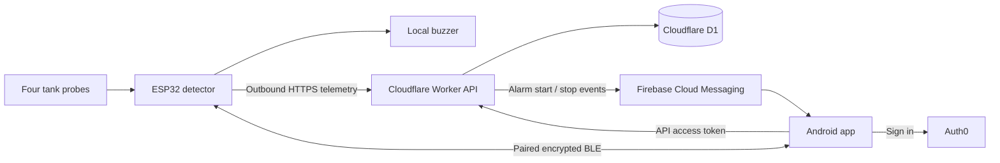
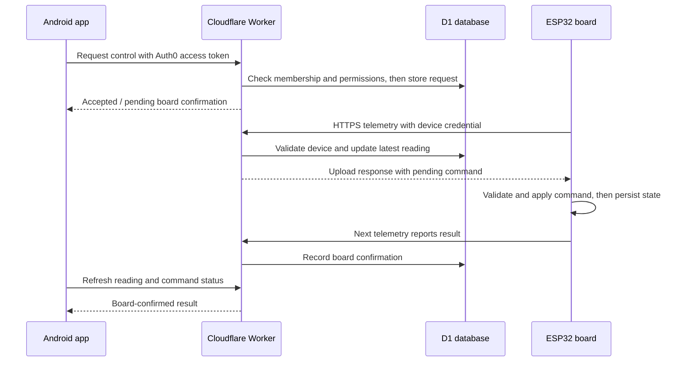
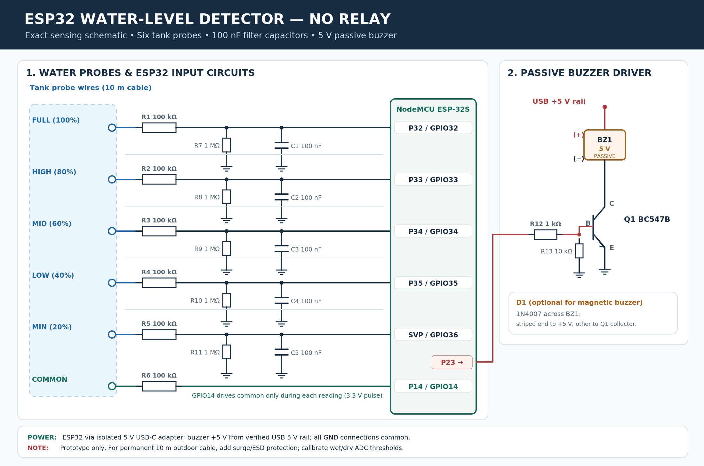
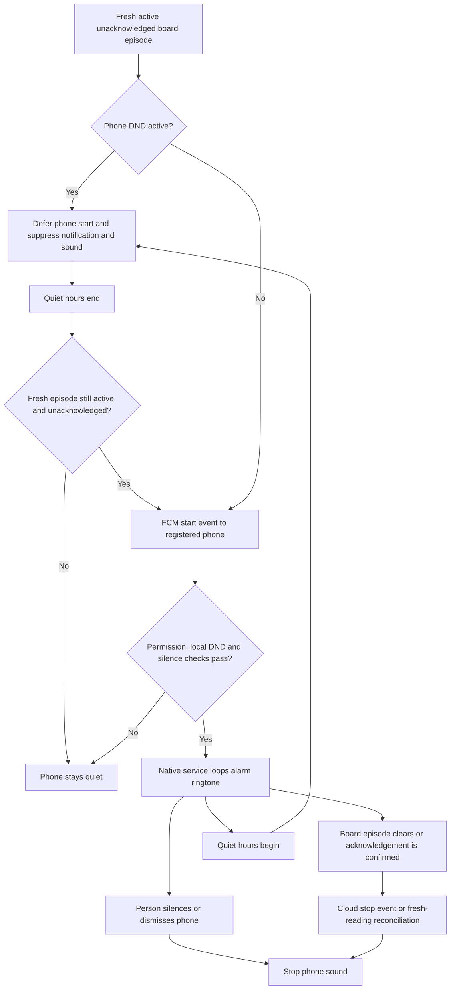

# Waterline

**An Android-first household water-level monitor with an ESP32 detector, secure cloud access, nearby Bluetooth controls and configurable alarms.**

Waterline turns a four-probe tank detector into a shared family application. The board measures water contact and runs its own buzzer; the app shows live readings, history, diagnostics and calibration, with remote access through Cloudflare and Auth0. Bluetooth provides nearby readings and controls when internet access is unavailable.

Current Android build: **0.2.14** · Package: `com.waterline.household` · Backend: `waterline-api`.

## What we built

| Component | Implementation |
| --- | --- |
| Android application | React, TypeScript and Capacitor, with native Auth0, Firebase messaging and ringtone handling |
| ESP32 detector | Arduino firmware built with PlatformIO for NodeMCU ESP-32S |
| Cloud API | Cloudflare Worker with authenticated household and device endpoints |
| Database | Cloudflare D1 for memberships, devices, latest readings, history, commands and phone delivery state |
| Account sign-in | Auth0 Universal Login, including Google sign-in through the configured connection |
| Offline nearby access | Bonded, authenticated Bluetooth Low Energy using NimBLE |
| Phone alarms | Firebase Cloud Messaging plus a native Android service for continuous ringtone playback |
| Visual design | Light blue theme, custom droplet/wave icon, varied card patterns, animated tank and stepped history charts |

### App screens

- **Landing:** sign in or connect to a nearby board. Sample/preview mode has been removed from the user interface.
- **Overview:** confirmed tank level band, animated water, reading age, connection source, probe states and alarm acknowledgement.
- **History:** 24-hour and seven-day charts, horizontally scrollable plotting with a fixed vertical axis, selectable readings and activity history.
- **Alarm:** active alarms, acknowledgement, per-level timing, buzzer testing, automatic alarm controls and phone notification registration.
- **Bluetooth:** connect, pair and disconnect from a nearby board; inspect its connection status.
- **Profile menu:** account details, Settings, Calibration, Probes, Household and connection options.
- **Settings:** tank and household preferences, English/Bengali language selection, phone DND scheduling and app information.
- **Calibration:** guided DRY/WET captures, preparation checkboxes, 20-cycle progress and a horizontally scrollable results table.
- **Probes:** raw ADC, filtered median, wet/dry/unknown state and saved calibration for each electrode.
- **Household:** owner-managed email access, member roles, long-press removal and member self-service leaving.

The interface includes themed dropdowns and a clock picker, sign-in progress, inline errors, permission overlays and command feedback. Decorative animation respects reduced-motion preferences and pauses for stale/background data.

## How it works



1. The ESP32 samples the electrodes, filters their readings and determines a confirmed level band.
2. On Wi-Fi, it initiates certificate-verified HTTPS telemetry uploads, normally every ten seconds. No inbound internet connection to the board is needed.
3. The backend recognizes the board using a provisioned device credential. The database stores its SHA-256 hash and binds it to a particular household.
4. The app signs in through Auth0. The backend validates the access token and checks household membership and permissions before serving data or accepting controls.
5. Cloud commands are returned to the board in its next telemetry response. Subsequent telemetry confirms execution; accepting a request does not mean the board has completed it.
6. Alarm episodes trigger phone delivery through FCM. The Android service can loop the phone alarm sound until it is silenced/dismissed or the episode is stopped.
7. Nearby BLE can supply readings and supported controls without board or phone internet. The connection survives app tab changes.

The app defaults to fresh Cloud readings and falls back to fresh connected Bluetooth data when Cloud is unavailable. Explicit source selection remains explicit, and commands retain the source selected when submitted. **History and app calibration capture require Cloud; Bluetooth capture is not implemented.** Bluetooth readings are not uploaded as cloud history by the phone.

### Cloud readings and command confirmation

The board starts every cloud exchange. A phone command waits for the next upload response, and the app shows completion only after the board reports it.



## Probe hardware and calibration

| Electrode / output | ESP32 pin | Function |
| --- | --- | --- |
| 20% | GPIO36 | Minimum-level probe; dry contact triggers the low-water rule |
| 50% | GPIO34 | Mid-level probe |
| 80% | GPIO33 | High-level probe |
| 100% | GPIO32 | Full-level probe |
| Common electrode | GPIO14 | Pulsed probe excitation |
| Buzzer output | GPIO23 | Local alarm output through the detector's buzzer circuit |

### Reference sensing schematic



This reference drawing shows five level electrodes (20/40/60/80/100%) and a passive buzzer driver. The current firmware uses four levels (20/50/80/100%), with GPIO34 assigned to 50% and GPIO35 unused. Follow the pin table above for the current implementation.

The detector reports **bands**, such as `50–80%` or `80–100%`, rather than an exact water volume. Probe positions must match the intended tank levels. Invalid, inconsistent, saturated or uncalibrated inputs are not presented as a confirmed level.

Calibration captures DRY first, then WET, using **20 measurement cycles** per capture. Each capture takes roughly 100 seconds after delivery. The saved wet/dry difference must exceed **500 ADC counts**. “Separation” refers to the difference between electrical readings, not physical electrode spacing. Adding an electrode can change common-excitation loading, so recalibrate all four channels together.

The app requires physical-preparation confirmation and shows capture delivery, progress and per-probe results. Calibration and alarm settings are persisted on the board. See the [firmware guide](ESP32_Water_Level_Detector/README.md) for sensing, wiring and installation details.

**Pump switching is not implemented.** The photographed motor starter and its reference material informed future integration; the application currently monitors water and controls buzzer alarms. A verified electrical interface and physical commissioning are still required for motor control.

## Alarms and phone DND

There are four independently configurable rules:

| Rule | Trigger | Initial timing |
| --- | --- | --- |
| Below 20% | 20% probe becomes dry | 60-second intermittent beep burst, then 540 seconds silent |
| 50% | 50% probe becomes wet | 10 seconds sound, then 50 seconds silent |
| 80% | 80% probe becomes wet | 10 seconds sound, then 50 seconds silent |
| 100% | 100% probe becomes wet | 10 seconds sound, then 50 seconds silent |

Timing and enabled state can be changed in the app. The highest active unacknowledged upper-level rule determines the board's sound rhythm. Episodes re-arm when the relevant contact clears and later triggers again. Settings and board acknowledgements survive restart.

- **Acknowledge:** requests acknowledgement of current board episodes. The app waits for board confirmation. Available from Overview and Alarm, including for Viewers.
- **Silence / dismiss phone:** stops local phone ringing without acknowledging the board. Delayed messages for the same silenced episode do not restart it.
- **Test buzzer:** sounds the board for ten seconds and disables its automatic alarms; re-enable them after testing.
- **Phone ringtone test:** verifies the native looping sound and local silence control.
- **Phone DND:** a personal on/off schedule in Settings, with start/end times and overnight support. During quiet hours the app suppresses phone notifications and sound. The board buzzer continues independently.

At the end of DND, the cloud scheduler rechecks the board and can deliver still-active, unacknowledged episodes. Allow approximately one scheduler minute plus network/FCM delay. DND does not bypass Android's own sound/channel policies. Phone alarms depend on connectivity, notification permission and Android background restrictions; they are not guaranteed exact-time alarm-clock delivery.

### Phone alarm lifecycle

Local silence affects the phone; board acknowledgement affects the alarm episode. Quiet hours defer phone alerts while board alarms continue independently.



## Family access

The Owner adds a person's **email address** and assigns Viewer or Operator access. That person installs the app, signs in with the same verified email and accepts the matching pending household access. Sharing an invitation link is no longer part of the normal flow. Public sign-up does not create an Owner.

| Cloud action | Owner | Operator | Viewer |
| --- | :---: | :---: | :---: |
| View readings, history and probe diagnostics | Yes | Yes | Yes |
| Acknowledge active alarms | Yes | Yes | Yes |
| Configure own phone notifications and DND | Yes | Yes | Yes |
| Test / enable / disable board buzzer | Yes | Yes | No |
| Edit level-alarm timing and household preferences | Yes | No | No |
| Capture calibration | Yes | No | No |
| Add, revoke or change family access | Yes | No | No |
| Leave own household | No | Yes | Yes |

The Owner cannot leave or remove the Owner through the current interface. Other members can leave their own household but cannot manage other members. Membership removal also removes that member's registered cloud phone subscriptions.

**BLE access is separate:** someone paired with the private board code has local control independently of Auth0 roles. Removing cloud membership does not revoke a Bluetooth bond. Use the board's authenticated Bluetooth management page to forget phones and rotate the pairing code.

## Security and stored data

- **Cloud transport:** HTTPS with certificate validation. No router port forwarding is required by this design; exposure still depends on router/network configuration.
- **Accounts:** native Auth0 Authorization Code + PKCE. Android credentials use the SDK's Keystore-backed encrypted storage. A client secret is not embedded in the app.
- **Authorization:** the API validates RS256 signatures, issuer, audience and expiry, then enforces household roles server-side.
- **Device authentication:** the private credential is held in an ignored firmware header; D1 holds only its hash. Device uploads cannot choose a different household.
- **Bluetooth:** bonding, private passkey authentication and encrypted characteristic access.
- **Push sender:** the Firebase service-account key is a Worker secret named `FCM_SERVICE_ACCOUNT`, not an APK asset or repository file.
- **ESP32 storage:** ordinary NVS persists Wi-Fi configuration, calibration, alarms and BLE pairing state. **Flash encryption, NVS encryption and Secure Boot are not enabled by this project.** Transport encryption does not protect firmware/credentials from physical extraction.
- **Local setup:** the board's authenticated setup/admin page uses HTTP. Use it on a trusted local network.

D1 holds household/member records, desired device settings, latest telemetry, retained history, command/acknowledgement state, audit activity and registered-phone delivery/DND state. This project does not add application-level field encryption to D1 records. Device private headers, local environment files, Firebase configuration/keys, database working state and APKs are excluded by the root `.gitignore`.

## Database and polling optimizations

The backend and app were optimized after early live/history queries exhausted the development database quota:

- Live requests use a dedicated lightweight `/api/reading` endpoint rather than fetching history each time.
- Visible-app polling normally runs every **30 seconds**, with **five-second polling for pending commands** and backoff on failures/quota errors. Hidden apps stop polling.
- Household/history refresh runs every **15 minutes while open**. Opening History and pressing Refresh also fetch history; a short server cache limits repeated work.
- Board heartbeats update the latest reading and deliver commands. History stores **five-minute checkpoints**, meaningful state transitions and offline boundaries instead of every heartbeat.
- History retains **seven days**, with indexed range queries, server caching and hourly retention cleanup.
- Push work is driven by episode transitions and registration catch-up, with scheduled retries, rather than repeating on every unchanged upload.
- Structured usage measurements record database row counts without credentials or SQL text.

These changes reduce work; they do not guarantee a particular quota allowance. Actual consumption depends on devices, active phones, transitions, retries and the Cloudflare plan. History intentionally preserves transitions and gaps rather than every raw sample.

## Repository layout

```text
Water-Level/
├── README.md                        Project overview and current behavior
├── .gitignore                       Shared ignore rules for all components
├── APP_PLAN.md                      Original architecture / implementation plan
├── app/
│   ├── src/                         React interface, auth and native bridges
│   ├── shared/                      Shared models and validation
│   ├── worker/                      Cloud API, telemetry, commands and push
│   ├── migrations/                  D1 migrations
│   ├── android/                     Capacitor Android and native services
│   ├── tests/                       Automated app/backend regression tests
│   ├── scripts/                     Configuration, provisioning and checks
│   ├── public/ and assets/          Fonts, icon master and packaged artwork
│   └── wrangler.backend.jsonc       Dedicated API deployment configuration
└── ESP32_Water_Level_Detector/
    ├── src/ and include/            Detector, buzzer, HTTPS and BLE firmware
    └── platformio.ini               Board/toolchain configuration
```

Generated dependencies, builds, releases, private configuration and diagnostics remain local. The repository preserves the original app history and now tracks all source components from one root.

## Development and setup

### Prerequisites

- Node.js **24** and npm.
- Android development: JDK **21**, Android SDK **36**, and Android Studio or the Gradle wrapper. Minimum supported Android version is **7 / API 24**.
- Firmware development: PlatformIO and an ESP32 NodeMCU-32S board.
- Cloud deployment: a Cloudflare account with Workers/D1, an Auth0 Native application/API, and a Firebase Android application for phone notifications.

### App development

```powershell
cd app
npm ci
npm run cf:types
npm run db:migrate:local
npm run dev
```

The local UI runs at `http://127.0.0.1:5173`. Authenticated cloud features require the appropriate environment configuration and provisioned membership. The standalone browser login uses a separately configured Auth0 SPA; the Native application's Client ID is for Android.

### Android configuration and build

Copy `app/.env.android.example` to `app/.env.android.local` and set the public values:

```dotenv
VITE_AUTH0_DOMAIN=auth.devbuildtool.com
VITE_AUTH0_CLIENT_ID=YOUR_NATIVE_CLIENT_ID
VITE_AUTH0_AUDIENCE=https://waterline.devbuildtool.com/api
VITE_API_BASE_URL=https://waterline.devbuildtool.com
```

Register the callback/logout URL in the Auth0 Native application:

```text
com.waterline.household://auth.devbuildtool.com/android/com.waterline.household/callback
```

Authorize that application for user-delegated access to the API. Configure refresh-token support for session renewal. For phone notifications, supply the Firebase Android configuration at `app/android/app/google-services.json`.

From `app/`:

```powershell
npm run android:sync
cd android
.\gradlew.bat assembleDebug --no-daemon
.\gradlew.bat lintDebug --no-daemon
```

Output: `app/android/app/build/outputs/apk/debug/app-debug.apk`. Run `android:sync` after interface or public configuration changes. Debug APKs and copied release artifacts are intentionally not tracked in Git. Production distribution still requires release signing and store/distribution setup.

### Cloud backend

1. Adapt `app/wrangler.backend.jsonc` for your own Cloudflare account, domain and D1 database. The committed values describe this deployment, not a reusable account credential.
2. Set matching Auth0 issuer/audience values and apply the D1 migrations.
3. Provision the first household and verified Owner explicitly; then provision the device credential. Review provisioning scripts and generated SQL for the intended household/device before running them.
4. Configure a dedicated Firebase sender and deploy its service-account JSON as the `FCM_SERVICE_ACCOUNT` Worker secret.
5. Validate and deploy from `app/`:

```powershell
npm run db:migrate:remote
npm run backend:check
npm run backend:deploy
node scripts/verify-backend.mjs https://waterline.devbuildtool.com
```

`backend:check` is a dry run; `backend:deploy` publishes. `wrangler.jsonc` is the optional browser application configuration, so use the dedicated backend command to update the API. See [BACKEND.md](app/BACKEND.md) for provisioning details; early deployment notes there describe earlier behavior, superseded by the current summary above.

### ESP32 firmware

Copy `include/wifi_secrets.example.h` to `include/wifi_secrets.h` and set a unique device admin/setup password. Provision `include/cloud_secrets.h` using the device provisioning workflow; do not replace an existing credential accidentally. Review the endpoint and CA trust configuration for your deployment.

```powershell
cd ESP32_Water_Level_Detector
pio run
pio run --target upload --upload-port YOUR_SERIAL_PORT
pio device monitor --port YOUR_SERIAL_PORT --baud 115200
```

Override the committed local COM-port defaults on your machine. Configure home Wi-Fi through the board setup page, then calibrate all four electrodes. Supported existing controls/settings can be changed through Cloud or BLE without plugging the board into a computer. Firmware changes still require a supported update/flash procedure.

## Validation and current limits

The latest documented release passed **147 automated tests**, TypeScript checks, Android debug build/lint and APK signature verification. Physical-phone inspection checked Settings/Calibration width, the clock picker, dirty-save highlighting and aligned controls at a 392 px viewport. Earlier user checks confirmed real cloud readings, offline BLE readings/buzzer testing, notification sound, continuous ringtone testing and immediate local silence.

```powershell
cd app
npm test
npm run typecheck
npm run build:android
npm run backend:check
```

A successful notification send is not proof that a phone rang. Background alarm start/stop delivery and end-of-DND ringing still require a full physical test during a real board episode. Large-text, battery-policy and manufacturer-specific background behavior also need continued device testing. Motor control, self-service device enrollment, production release signing and ESP32 storage hardening remain outside the completed scope.

The latest local APK was approximately **8.18 MiB** (8,576,403 bytes). It is a debug/test build, not a published Play Store release. No firmware changes were needed for the most recent Settings/History/Calibration layout update.

## Further documentation

- [Android setup](app/ANDROID.md)
- [Backend deployment and provisioning](app/BACKEND.md)
- [Bluetooth pairing and protocol](app/BLUETOOTH.md)
- [Firebase sender setup](app/NOTIFICATIONS.md)
- [Redesign and subsequent release notes](app/REDESIGN.md)
- [Verification record](app/VERIFICATION.md)
- [Firmware, sensing and installation](ESP32_Water_Level_Detector/README.md)

Some component documents retain early deployment/version notes. Use this README for current behavior and the release notes for later changes. Credentials and household exports must remain outside source control, including in this private repository.
